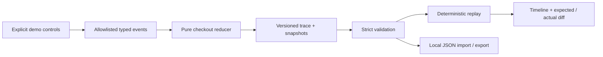

# TRACEKIT

**Make bugs reproducible.** A tiny TypeScript event recorder and a client-side debugging workbench for an explicitly instrumented, synthetic checkout.

[Open the workbench](https://seoshiro.github.io/tracekit/) · [Core package](packages/tracekit) · [Security and independent audit](docs/AUDIT.md)

TRACEKIT records allowlisted **application events and state**, then deterministically replays them. It demonstrates a focused instrumentation pattern. It does not record arbitrary websites, video, the DOM, network traffic, passwords, cookies, or real customer details. The demo has no payment flow or backend.

## Try it in 30 seconds

1. Select **The ghost discount** and press **Run 30s demo**.
2. Inspect the event timeline. Removing TRACE10 leaves a stale discount in the intentionally buggy checkout.
3. Switch to **Fixed logic**. The same events now recompute the correct total; the diff resolves.
4. Export the versioned JSON report, reset, and import it to reproduce the exact recording.

The second scenario, **Express, at a slow price**, selects express shipping while the legacy total keeps its old delivery charge. You can also create your own trace using quantity, coupon, shipping, and simulated checkout controls. All products, coupons, prices, and events are synthetic.

English and Russian are built in. Every action is keyboard accessible; dialogs support Escape and focus return. The workbench adapts to narrow screens and respects reduced motion.

## Run locally

Requires Node.js 24+ and npm. No account, environment file, API key, paid service, or server is needed.

```sh
npm ci
npm run dev
# http://127.0.0.1:5183/tracekit/
```

```sh
npm run check         # unit/security tests, core declarations, app production build
npx playwright install chromium
npm run test:e2e      # production preview, Chromium, one worker
```

The development server is only a local build tool. The published application consists of static HTML, CSS, JavaScript and SVG.

## TypeScript API

The private, dependency-free `@tracekit/core` package lives in this repository and is deliberately not published to npm. Build its ESM and declarations with `npm run build:core`. Import its source in a TypeScript application, or the generated `packages/tracekit/dist/index.js` in Node.

```ts
import {
  recordTrace,
  replayTrace,
  compareStates,
  exportTrace,
  importTrace,
  scenarioEvents,
} from './packages/tracekit/src/index';

const trace = recordTrace(scenarioEvents('coupon-ghost'), 'coupon-ghost', 'buggy');
const actual = replayTrace(trace);
const expected = replayTrace(trace, 'fixed');
const differences = compareStates(expected.at(-1)!, actual.at(-1)!);
// discountCents: expected 0, actual 1780
// totalCents: expected 18300, actual 16520

const restored = importTrace(exportTrace(trace));
// replayTrace(restored) is deeply equal to actual.
```

Every replay result contains the initial state at index 0, then one state per event. `compareStates(expected, actual)` returns stable field-level differences. Money is integer USD cents. Logical event times are `seq * 420` milliseconds; these are deterministic ordering markers, not measured session timings. The mode override replays the same events through the fixed reducer without changing the original recording.

| API                                            | Purpose                                                        |
| ---------------------------------------------- | -------------------------------------------------------------- |
| `initialState()`                               | Fresh canonical checkout state                                 |
| `reduceCheckout(state, event, mode, scenario)` | Pure, validated state transition                               |
| `recordTrace(events, scenario, logic)`         | Snapshot allowlisted events and derived state                  |
| `replayTrace(trace, mode?)`                    | Validate and recompute states from events                      |
| `compareStates(expected, actual)`              | Typed field-level differences                                  |
| `exportTrace(trace)` / `importTrace(json)`     | Strict schema-v1 serialization, throws `Error` on invalid data |
| `scenarioEvents(scenario)`                     | Independent copies of reproducible example events              |

Supported events are `cart.quantity` (1–9), `coupon.apply` (TRACE10 only), `coupon.remove`, `shipping.select` (standard/express), and `checkout.submit`. Scenario IDs are `coupon-ghost` and `shipping-drift`; logic modes are `buggy` and `fixed`. Types `DemoEvent`, `CheckoutState`, `Trace`, `TraceEntry`, `Difference`, `LogicMode`, and `ScenarioId` are exported.

## Architecture



- `packages/tracekit/src/index.ts`: no React, clock, randomness, DOM, storage, or networking. Inputs and outputs are copied; unknown fields and executable accessors are rejected.
- `src/`: React workbench, localized copy and CSS. Transient state stays in memory; refreshing clears it. JSON leaves the page only when the user downloads it.
- `tests/`: core invariants, independent adversarial import tests, and browser journeys.
- `.github/workflows/`: quality checks, static Pages deployment, and live browser verification.
- `scripts/manifest.mjs`: embeds the source commit and SHA-256 of each built asset in `release-manifest.json`.

## Data safety and limits

Schema version 1 accepts at most 100 events and 128 KiB of UTF-8 JSON. The importer checks exact keys at every object level, enum values, safe integer bounds, canonical initial state, event order, logical timestamps, and every stored snapshot against a fresh deterministic replay. A file with extra fields, unsupported versions, personal-data fields, prototype keys or modified totals is rejected as a whole. Import errors leave the current trace intact.

This is structural validation, not cryptographic authenticity. Another person can create a valid synthetic trace; a JSON file is not proof of a real session. The release manifest proves asset correspondence to a source SHA when checked against the repository; it is not a signature.

No analytics, remote fonts, third-party requests, persistence, backend, cookies, secrets or payment integration are used by the app. A Content Security Policy blocks app-initiated network connections. GitHub Pages, like any hosting provider, receives ordinary requests for the static site itself.

The core schema and reducer intentionally describe this checkout only. Integrating a different application requires a new explicit event/state model, validator and reducer. There is no generic SDK that automatically instruments arbitrary sites. Schema upgrades need a deliberate migration; unknown versions fail closed. The UI playback timer only advances the selected event; it does not influence deterministic state.

## Release verification

CI runs with one browser worker and installs no paid services. Deployment runs only after tests and the production build pass. The live job rebuilds the source commit, compares its manifest with production, hashes every served asset, and runs the browser suite against the published URL. To repeat:

```sh
PLAYWRIGHT_BASE_URL=https://seoshiro.github.io/tracekit/ npm run test:e2e
npm run build # from the expected clean source commit
node scripts/verify-release.mjs https://seoshiro.github.io/tracekit/ SOURCE_COMMIT_SHA
```

In PowerShell, set `$env:PLAYWRIGHT_BASE_URL = 'https://seoshiro.github.io/tracekit/'` before the test command. See [release evidence](docs/RELEASE.md) for the actual result, commit and screenshots. CI green and production verification are reported separately.

## Русский

TRACEKIT — инструмент для воспроизводимых отчётов об ошибках на встроенном checkout. Нажмите **EN / RU**, запустите демо, выберите событие на шкале и включите исправленную логику. Можно записать собственные действия с синтетическими товарами и передать отчёт через JSON. Это демонстрация явного инструментирования приложения, а не универсальная запись чужих сайтов. Ничего вводить, регистрировать или оплачивать не нужно.

## License

MIT. Icons by [Lucide](https://lucide.dev), ISC license. React, Vite and the test tools retain their own licenses.
