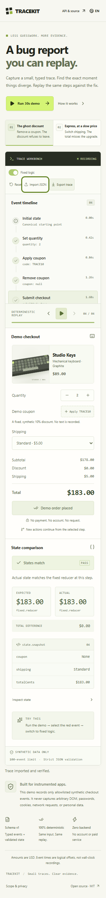

# Independent audit and repair — 23 October 2026

Production: <https://seoshiro.github.io/tracekit/>. Remote baseline verified independently: `801154dac7eb2d8774d5e8e066f56d0e832d3198` (`v1.0.0`). Original source was preserved in a separate clean audit clone. Four new independent reviewers covered algorithms, security/data, browser UX, and performance/release; the integrator alone changes source and publishes.

## Reproduced findings and fixes

### TK-01 — P2: obsolete file reads overwrite a new import

Reproduce in a fresh production context: open Import JSON, choose a small file A whose `File.text()` completion is deferred, press Escape, reopen import, type a newer draft, then release A. Expected: newer draft remains. Actual: A replaces it. A second reproduction chooses fast B while slow A is pending: after B appears, A replaces B. The browser timing hook delays a real small synthetic file read; it does not load the published site.

Repair: generation tokens invalidate old work on open/close, tab changes, newer file selection and manual edits. Text/error/loading updates only apply to the current operation; Apply is disabled during a pending current read. New Playwright tests in `tests/import-audit.spec.ts` keep both reproductions. The unchanged independent browser helper changed 2 FAIL → 2 PASS.

Evidence: [closed-dialog before](before-import-race.png), [after](after-import-race.png), [A/B race before](before-two-files.png), [after](after-two-files.png), [exact before observations](import-races-before.json), [after observations](import-races-after.json).

### TK-02 — P2: unnamed Reset on mobile

Reproduce: fresh app at 320 CSS pixels, navigate the workbench toolbar with Tab, inspect Reset; repeat in RU. Expected: a visible localized name and accessible name. Actual: CSS hides its text span and the decorative SVG contributes no name; axe reports critical `button-name` in both languages. Repair: keep the text visible and add localized `aria-label`. Browser regression verifies both forms.

Evidence: [before mobile](before-reset-mobile.png), [after mobile](after-reset-mobile.png), [axe before EN](axe-before-en-320.json), [after EN](axe-after-en-320.json), [before RU](axe-before-ru-320.json), [after RU](axe-after-ru-320.json).

### TK-03 — P3: insufficient small-text contrast

Reproduce: default desktop hero, inspect the REPLAYABLE tag. Expected WCAG AA 4.5:1 for small text. Actual axe ratio 4.42:1 (`#657052` on `#e8eeda`). Repair: darker tag text, `#596547`. [Before](before-contrast.png), [after](after-desktop.png), [axe before](axe-before-initial.json), [axe after](axe-after-initial.json) (no violation).

### TK-04 — P3: strict object boundary omitted containing arrays

API reproduction: define `events[0]` as a getter returning `{type:'checkout.submit'}` and call `recordTrace`; hidden or inherited array indexes were also accepted. An accessor on `trace.entries[0]` executed during export/replay. Expected: reject non-data collections before index access. Actual: getter executes and non-enumerable/inherited entries are consumed. JSON cannot encode getters; this is the public JavaScript API contract, not a demonstrated remote exploit.

Repair: bounded dense plain-array validation checks own enumerable data descriptors and rejects extra/symbol/inherited/hidden indexes. `tests/array-boundary.test.ts` covers recording, export and replay. Independent boundary assertions changed FAIL → PASS without weakening their expectations.

## Verification

- [Independent algorithm results](independent-algorithm-results.json): 320 sequences / 15,973 events in both named scenarios; separate fixed arithmetic oracle, truthful expected/actual values at each state, deterministic replay and byte-stable round trips. Frozen/detached input/output tests passed. The deliberate buggy checkout scenarios remain deliberate.
- Unit/security suite: 61 tests; `build:core`, application TypeScript/build and formatting checks passed. Browser suite includes all existing journeys and the new race/mobile regressions.
- [Final-local browser evidence](browser-final-local.json): both locales at 320/390/768/1440, keyboard/focus/Escape, narrow JSON dialogs, state divergence → fixed replay, branching, quantity limits, export/reset/import, reduced motion and 720 CSS-pixel reflow. No unexpected JS, console or network errors. Cross-project final-local suite 63/63 PASS and all three import-race checks PASS.
- [Baseline hashes](source-live-baseline.json): clean built bytes matched production. [CI/Pages baseline](ci-pages-baseline.json) had succeeded; no pending release was retriggered.
- [Local measured performance](performance-baseline.json): complete 100-event record/replay/fixed/export/import workflow 3.6–9.9 ms on Node 24 Windows x64; not a browser/device benchmark. No speedup claim.
- [Dependency audit](dependency-audit-after.json): zero known advisories at audit time. Npm audit sends dependency manifests to its official registry service; zero advisories do not prove complete security.

Reproduce with `npm ci`, `npm run format:check`, `npm run check`, `npm run test:e2e`. The [independent cross-project harness](https://github.com/seoshiro/juryflow/blob/main/scripts/audit-independent.mjs) runs against the three sibling clones with an explicit seeded oracle; it was rerun after integration.

## Release evidence, tools and limitations

The [release workflow](https://github.com/seoshiro/tracekit/actions/workflows/release.yml) verifies quality, deploys Pages, rebuilds the exact source SHA, verifies manifest/file hashes and runs E2E against production. The [live manifest](https://seoshiro.github.io/tracekit/release-manifest.json) records the full deployed SHA; the matching Actions run and artifacts are the release verdict. Preserve baseline SHA above for rollback by a normal revert and verified redeploy; do not force-push. A local pre-commit preview is not a released version.

Actually used: installed instruction-only ECC-derived Windows engineering skill and quality/frontend/security/release references, `21st-ui-review` priorities, full-story `verification` and React review checklist; GitHub MCP metadata, existing Git/gh, PowerShell, Node/npm, TypeScript/Vite/Vitest, Playwright, axe, real Chrome-extension interaction/screenshots on the user's Windows computer. No repo AGENTS or `.agents/skills` were present; user Codex AGENTS was read. `21st` CLI was absent; no ECC runtime/hooks/service is claimed. All work used free existing resources; credentials, OAuth grants, security settings and unrelated repositories were untouched.

Chromium only; Firefox/WebKit unavailable, no Safari pass. No human screen-reader or native browser-zoom pass. 720 CSS-pixel reflow passed; artificial CSS zoom failures were excluded as an invalid browser-zoom method. Browser automation is not human usability research. Public sites received small ordinary journeys only; property/performance checks stayed local. TRACEKIT remains an explicitly instrumented synthetic checkout recorder, not a universal session recorder, payment implementation or production checkout library.
